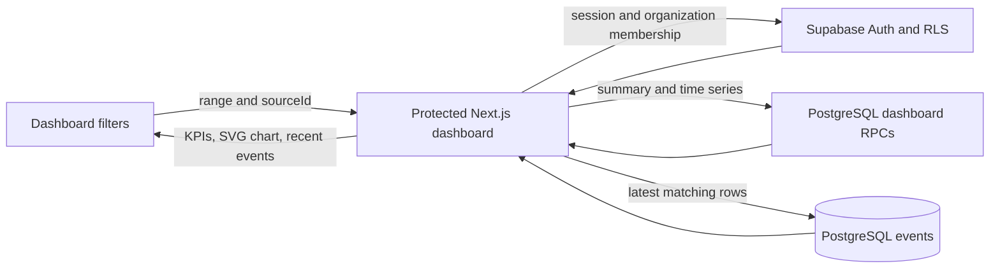

# Dashboard UI decisions

## Request-time rendering for tenant data

The dashboard reads the signed-in user's organizations, sources, event rows,
and aggregation RPCs on the server. This keeps tenant data behind the existing
Supabase session and RLS policies, avoids sending database credentials to the
browser, and gives the dashboard one consistent filtered result set. The trade
off is that dashboard requests depend on Supabase availability and do not use
a shared cached response.

The authenticated dashboard layout opts out of instant-navigation validation
because it must resolve the current session before it can render protected
content. Dashboard data is streamed behind a Suspense boundary with a small
loading state.

## URL-backed filters

Date range and source selection are submitted as query parameters. Links can be
bookmarked or shared within the same workspace, browser navigation restores the
selected filters, and the server applies the same filters to KPIs, chart data,
and recent events. The trade off is a full server navigation after applying a
filter rather than maintaining a separate client-side cache.

## Lightweight SVG chart

The event volume visualization is an accessible inline SVG with successful,
failed, and pending series. It avoids adding a charting dependency and keeps
the visual style aligned with the dashboard. The trade off is that new chart
types or richer interactions will require extending project-owned SVG code or
adopting a chart library later.

## Dashboard data flow

